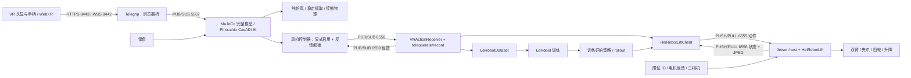
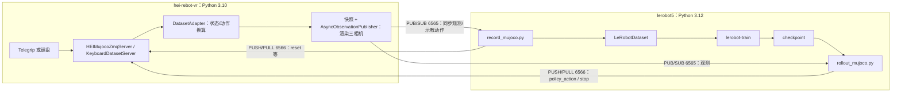
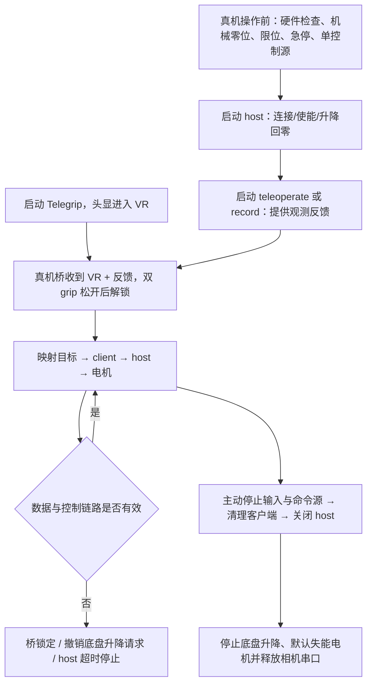

# HEI ReBot Lift：AI Agent 开发交接与知识索引

> 初始静态核查日期：2026-10-12；AGX 实机核查追加于 2026-10-13（Asia/Shanghai）。面向 Codex、GLM、DeepSeek、Claude Code 等开发代理。
> 本文是人工维护的项目入口，不依赖历史聊天才能使用，也不保证被所有工具自动加载；接手时应显式阅读。
> 第 1–15 节主要保留 2026-10-12 的静态分析快照；2026-10-13 的实机结果和代码修正见第 16 节。

## 1. 项目概览与核心目标

HEI ReBot Lift 是双臂、升降平台、四轮 O 型全向底盘和三相机组成的机器人项目，
覆盖硬件资料、VR/键盘遥操作、MuJoCo 仿真、示教数据采集、模仿学习/VLA 和实机执行。
当前运行主线是 **Python + LeRobot + ZMQ**；ROS 2 导航与机械臂规划是自研扩展方向，尚未实现。

| 项目 | 当前依据 |
| --- | --- |
| 母项目 | `https://github.com/lipengdong/hei-rebot-lift`，远端 `upstream` |
| 用户 Fork | `https://github.com/xiaofo059/hei-rebot-lift`，远端 `origin` |
| HEI 项目版本 | [VERSION](VERSION)：`0.2.0`；发布说明见 [CHANGELOG.md](CHANGELOG.md) |
| 内置 LeRobot | `0.6.2`；[UPSTREAM.md](software/lerobot-hei-rebot-lift/UPSTREAM.md) 记录基线 `b9cb121cb7d4e3e26ec5c906d08dda68d151ba52` |
| 当前分工 | 笔记本：PICO 4/MuJoCo、录制、训练及开发；Jetson AGX：实机 host、硬件接入及后续 ROS 执行 |
| 自研入口 | [extensions/README.md](extensions/README.md)、[extensions/ros2_ws/README.md](extensions/ros2_ws/README.md) |
| 当前阶段 | 用户已反馈 PICO 4 的 MuJoCo 遥操作成功；下一步建议固定基线并验证仿真录制—训练—推理闭环 |

**证据分级贯穿全文：**

- **[S 源码事实]**：本轮直接读取代码/配置/目录/Git 得到；不等于功能经过运行验证。
- **[T 本轮检查]**：本轮真正执行的静态检查；范围和结果见第 13 节。
- **[H 历史验证]**：此前本次协作中运行过的检查，或用户反馈；注明来源，本轮未重跑。
- **[D 文档声明]**：README 声称支持/跑通，但未在用户机器上核验。
- **[I 分析推断]**：根据实现发现的风险或建议，尚需测试确认。
- **[? 待确认]**：缺少机器、硬件、配置或实验信息。

资料优先级：当前用户任务和授权范围 → 实际代码/配置与适用开发规范 → 对应模块文档 → 本索引。
发现差异应说明并核对，不用旧文档覆盖源码事实，也不因为本文列有命令就自动执行。

## 2. AI Agent 接手项目的快速阅读指南

先用只读操作了解现场，不立即安装环境、同步分支或运行驱动：

```bash
# 项目根目录
pwd
git status --short --branch
git branch -vv
git remote -v
git log -5 --oneline
git ls-files
```

以下 Markdown 链接目标均为**相对项目根目录的实际路径**。只需选与任务有关的 P2/P3，
不要一开始读取所有策略、网格或测试工件。英文读者可从同目录的英文 README 获取对应说明。
为控制上下文用量，首次先读本文第 1、2、13、14 节；按第 12 节任务路由选择源码，
需要核对端口/单位再读第 8 节，需要启动再读第 9–11 节。其余章节作为按需检索的架构手册。

### P0：首先阅读，确立边界

| 顺序与文件 | 作用 / 为什么先读 | 依赖与注意点 |
| --- | --- | --- |
| 1. [README_FOR_AGENTS.md](README_FOR_AGENTS.md) | 当前架构、任务路由、证据等级和交接状态 | 全项目索引；动态状态以重新检查为准 |
| 2. [README_zh.md](README_zh.md) | 整机概览、安装角色、仿真与实机启动 | 不把电脑 IP 与机器人 IP 混用；命令可能引起运动 |
| 3. [docs/git_workflow_zh.md](docs/git_workflow_zh.md) | main/dev、功能分支、双机同步、自研目录及部署版本 | 采用最新工作区内容；文档中的规划目录并非全部已创建 |
| 4. [docs/README_zh.md](docs/README_zh.md) | 子文档职责、语言和参数同步规则 | 找到领域教程，不重复维护安装说明 |
| 5. [软件 AGENTS.md](software/lerobot-hei-rebot-lift/AGENTS.md) | 软件子树的依赖、类型、导入、检查规范 | 修改该子树前读；其中部分概览路径有历史表述，需以当前树核对 |
| 6. [UPSTREAM.md](software/lerobot-hei-rebot-lift/UPSTREAM.md) | LeRobot 基线和 HEI 必须保留的集成边界 | 与 CHANGELOG、pyproject、robot 注册一起检查升级 |

### P1：理解主架构，再定位模块

| 文件 | 主要作用 / 推荐原因 | 依赖关系 |
| --- | --- | --- |
| [软件 README_zh.md](software/lerobot-hei-rebot-lift/README_zh.md) | 软件模块导航，区分 LeRobot 通用功能和 HEI 工作流 | 根 README、examples、driver |
| [pyproject.toml](software/lerobot-hei-rebot-lift/pyproject.toml) | 包版本、Python 约束、extras、CLI 映射、Ruff/Mypy/Pytest 配置 | 安装和脚本入口的实际依据 |
| [HEI examples README_zh.md](software/lerobot-hei-rebot-lift/examples/hei_rebot_lift/README_zh.md) | 调试→遥操作→录制→清洗→训练→实机推理 | 所有 HEI 客户端及 host |
| [驱动 README_zh.md](software/lerobot-hei-rebot-lift/src/lerobot/robots/hei_rebot_lift/README_zh.md) | 设备、单位、配置与看门狗说明 | 必须与下列配置和实现一起看 |
| [config_hei_rebot_lift.py](software/lerobot-hei-rebot-lift/src/lerobot/robots/hei_rebot_lift/config_hei_rebot_lift.py) | 串口、电机、限位、相机和网络默认值 | RobotConfig 注册；host/client 共用约定 |
| [hei_rebot_lift.py](software/lerobot-hei-rebot-lift/src/lerobot/robots/hei_rebot_lift/hei_rebot_lift.py) | `HeiRebotLift`、各执行机构 runtime、18 维接口 | Damiao U2CAN、串口 IO、相机工厂 |
| [hei_rebot_lift_host.py](software/lerobot-hei-rebot-lift/src/lerobot/robots/hei_rebot_lift/hei_rebot_lift_host.py) | ZMQ 接收动作、发送观测、超时处理与退出 | 直接调用实机驱动，会连接、使能和回零 |
| [hei_rebot_lift_client.py](software/lerobot-hei-rebot-lift/src/lerobot/robots/hei_rebot_lift/hei_rebot_lift_client.py) | HEI 客户端字段和新旧观测协议兼容 | 继承 [lekiwi_client.py](software/lerobot-hei-rebot-lift/src/lerobot/robots/lekiwi/lekiwi_client.py)，网络及缓存逻辑在父类 |
| [VR README_zh.md](software/lerobot-hei-rebot-lift/examples/hei_rebot_lift/VR_mujoco_ik/README_zh.md) | 仿真/实机入口、手柄、环境与解锁条件 | Telegrip、完整模型控制器、VRActionReceiver |
| [ROS 工作空间 README](extensions/ros2_ws/README.md) | 自研包边界、预定命名和构建方式 | 当前只是骨架，不存在已部署的 ROS 2 控制链路 |

### P2：按开发对象深入，不必一次读完

| 文件或精确入口 | 作用 / 推荐原因 | 依赖关系 |
| --- | --- | --- |
| [telegrip/README_zh.md](software/lerobot-hei-rebot-lift/examples/hei_rebot_lift/VR_mujoco_ik/telegrip/README_zh.md)、[config.yaml](software/lerobot-hei-rebot-lift/examples/hei_rebot_lift/VR_mujoco_ik/telegrip/config.yaml) | WebXR、端口与可选图像回传 | HTTPS/WSS、ZMQ；图像回传默认关闭 |
| [telegrip/__main__.py](software/lerobot-hei-rebot-lift/examples/hei_rebot_lift/VR_mujoco_ik/telegrip/telegrip/__main__.py)、[vr_ws_server.py](software/lerobot-hei-rebot-lift/examples/hei_rebot_lift/VR_mujoco_ik/telegrip/telegrip/inputs/vr_ws_server.py) | 网页服务、WebSocket 接收和 ZMQ 发布 | 前端消息原样进入 VR 数据通道 |
| [web-ui/index.html](software/lerobot-hei-rebot-lift/examples/hei_rebot_lift/VR_mujoco_ik/telegrip/web-ui/index.html)、[vr_app.js](software/lerobot-hei-rebot-lift/examples/hei_rebot_lift/VR_mujoco_ik/telegrip/web-ui/vr_app.js) | PICO/Quest 兼容性、位姿/按钮字段的入口 | A-Frame 手柄实体、WebXR inputSources；不要只看 Python 接收端 |
| [mujoco_ik/README_zh.md](software/lerobot-hei-rebot-lift/examples/hei_rebot_lift/VR_mujoco_ik/mujoco_ik/README_zh.md) | 仿真入口与 IK 平滑说明 | 完整模型、旧双臂模型、数据及物理教程 |
| [hei_robot_vr_mujoco_sim.py](software/lerobot-hei-rebot-lift/examples/hei_rebot_lift/VR_mujoco_ik/mujoco_ik/hei_robot_vr_mujoco_sim.py) | 完整模型控制、目标过滤、工作空间约束、稳定抓取 | Kinematics、场景构建；多个模式的基类 |
| [pinocchio_kinematic.py](software/lerobot-hei-rebot-lift/examples/hei_rebot_lift/VR_mujoco_ik/mujoco_ik/src/pinocchio_kinematic.py) | `Kinematics` 的 FK、CasADi/IPOPT IK、限位与连续性 | URDF reduced model；同时影响仿真和真机桥 |
| [hei_robot_keyboard_mujoco_sim.py](software/lerobot-hei-rebot-lift/examples/hei_rebot_lift/VR_mujoco_ik/mujoco_ik/hei_robot_keyboard_mujoco_sim.py) | 键盘模式及相对 TCP 操作 | 复用 VR 仿真基类，替换输入 |
| [hei_robot_vr_mujoco_real.py](software/lerobot-hei-rebot-lift/examples/hei_rebot_lift/VR_mujoco_ik/mujoco_ik/hei_robot_vr_mujoco_real.py)、[vr_control.py](software/lerobot-hei-rebot-lift/examples/hei_rebot_lift/vr_control.py) | 真机桥、反馈解锁、单位转换与完整动作 | 6558 动作、6559 反馈，再由 client 发至 host |
| [hei_robot_mujoco_scene.py](software/lerobot-hei-rebot-lift/examples/hei_rebot_lift/VR_mujoco_ik/mujoco_ik/hei_robot_mujoco_scene.py)、[hei_robot_mujoco_physics_scene.py](software/lerobot-hei-rebot-lift/examples/hei_rebot_lift/VR_mujoco_ik/mujoco_ik/hei_robot_mujoco_physics_scene.py) | URDF→场景、相机与物体；接触场景构建 | VR/键盘模拟器与快照渲染器 |
| [hei_robot_vr_mujoco_physics.py](software/lerobot-hei-rebot-lift/examples/hei_rebot_lift/VR_mujoco_ik/mujoco_ik/hei_robot_vr_mujoco_physics.py)、[hei_robot_keyboard_mujoco_physics.py](software/lerobot-hei-rebot-lift/examples/hei_rebot_lift/VR_mujoco_ik/mujoco_ik/hei_robot_keyboard_mujoco_physics.py) | 接触物理、软吸附及无辅助模式 | `mj_step`；与稳定抓取采集模式区分 |
| [SIM_DATASET_WORKFLOW_zh.md](software/lerobot-hei-rebot-lift/examples/hei_rebot_lift/VR_mujoco_ik/mujoco_ik/SIM_DATASET_WORKFLOW_zh.md) | 仿真采集、可视化、训练及推理步骤 | 两环境、独立服务端/客户端 |
| [hei_robot_mujoco_zmq_protocol.py](software/lerobot-hei-rebot-lift/examples/hei_rebot_lift/VR_mujoco_ik/mujoco_ik/hei_robot_mujoco_zmq_protocol.py) | 18 维顺序、三相机、编解码和 hold action | MuJoCo 与 LeRobot 共同依赖的轻量协议 |
| [hei_robot_mujoco_dataset_adapter.py](software/lerobot-hei-rebot-lift/examples/hei_rebot_lift/VR_mujoco_ik/mujoco_ik/hei_robot_mujoco_dataset_adapter.py) | 仿真状态/动作与实机 schema 换算、渲染快照 | 协议、模型和模拟器 |
| [hei_robot_mujoco_zmq_server.py](software/lerobot-hei-rebot-lift/examples/hei_rebot_lift/VR_mujoco_ik/mujoco_ik/hei_robot_mujoco_zmq_server.py)、[hei_robot_keyboard_dataset_server.py](software/lerobot-hei-rebot-lift/examples/hei_rebot_lift/VR_mujoco_ik/mujoco_ik/hei_robot_keyboard_dataset_server.py) | VR/策略与键盘数据服务端 | adapter、模拟器、[异步发布器](software/lerobot-hei-rebot-lift/examples/hei_rebot_lift/VR_mujoco_ik/mujoco_ik/hei_robot_mujoco_observation_publisher.py) |
| [record_mujoco.py](software/lerobot-hei-rebot-lift/examples/hei_rebot_lift/VR_mujoco_ik/mujoco_ik/record_mujoco.py)、[rollout_mujoco.py](software/lerobot-hei-rebot-lift/examples/hei_rebot_lift/VR_mujoco_ik/mujoco_ik/rollout_mujoco.py) | 仿真采集客户端与策略客户端 | 轻量协议 + LeRobot，不在采集客户端导入 MuJoCo |
| [teleoperate.py](software/lerobot-hei-rebot-lift/examples/hei_rebot_lift/teleoperate.py)、[record.py](software/lerobot-hei-rebot-lift/examples/hei_rebot_lift/record.py) | 实机遥操作与数据录制 | HeiRebotLiftClient、VRActionReceiver、processor/datasets |
| [replay.py](software/lerobot-hei-rebot-lift/examples/hei_rebot_lift/replay.py)、[evaluate.py](software/lerobot-hei-rebot-lift/examples/hei_rebot_lift/evaluate.py)、[rollout.py](software/lerobot-hei-rebot-lift/examples/hei_rebot_lift/rollout.py) | 实机回放、ACT 评估录制、通用策略执行 | 数据/模型→client；退出也可能发运动指令 |
| [dm_can.py](software/lerobot-hei-rebot-lift/src/lerobot/motors/damiao_u2can/dm_can.py) | `Motor`、`MotorControl`、协议帧、模式和参数读写 | HEI 专用串口 U2CAN 实现；与通用 Damiao 后端区分 |
| [lerobot_dataset.py](software/lerobot-hei-rebot-lift/src/lerobot/datasets/lerobot_dataset.py)、[dataset_writer.py](software/lerobot-hei-rebot-lift/src/lerobot/datasets/dataset_writer.py)、[dataset_metadata.py](software/lerobot-hei-rebot-lift/src/lerobot/datasets/dataset_metadata.py) | 数据集外观、写入与元数据 | record→LeRobotDataset→writer/reader；不是只有 Hugging Face datasets 包 |
| [lerobot_train.py](software/lerobot-hei-rebot-lift/src/lerobot/scripts/lerobot_train.py)、[configs/train.py](software/lerobot-hei-rebot-lift/src/lerobot/configs/train.py)、[policies/factory.py](software/lerobot-hei-rebot-lift/src/lerobot/policies/factory.py) | 训练入口、配置、策略/processor 工厂 | datasets、optim、distributed、checkpoint |
| [rollout/context.py](software/lerobot-hei-rebot-lift/src/lerobot/rollout/context.py)、[strategies/base.py](software/lerobot-hei-rebot-lift/src/lerobot/rollout/strategies/base.py)、[strategies/core.py](software/lerobot-hei-rebot-lift/src/lerobot/rollout/strategies/core.py) | 上下文构建、执行循环与退出复位 | [configs.py](software/lerobot-hei-rebot-lift/src/lerobot/rollout/configs.py)、sync/RTC、robot/processor |
| [HEI_robot_urdf/README_zh.md](software/lerobot-hei-rebot-lift/examples/hei_rebot_lift/VR_mujoco_ik/mujoco_ik/model/HEI_robot_urdf/README_zh.md)、[实际 URDF](software/lerobot-hei-rebot-lift/examples/hei_rebot_lift/VR_mujoco_ik/mujoco_ik/model/HEI_robot_urdf/urdf/HEI_robot_urdf.urdf) | 关节、TCP、夹爪和传感器模型 | IK、MuJoCo、后续 ROS description 的几何依据 |

### P3：调试、测试、部署时按需查阅

| 文件 | 作用 / 使用原因 | 依赖或边界 |
| --- | --- | --- |
| [hardware/README_zh.md](hardware/README_zh.md)、[HEI_ReBot_Lift_BOM.md](hardware/HEI_ReBot_Lift_BOM.md) | 硬件索引、器件和加工资料 | CAD/装配/实物共同核对，不把 BOM 当现场配置 |
| [environment.yml](software/lerobot-hei-rebot-lift/examples/hei_rebot_lift/VR_mujoco_ik/environment.yml)、[uv.lock](software/lerobot-hei-rebot-lift/uv.lock) | VR 依赖组合、LeRobot 开发锁定 | 两套 Python 环境，不互相替代 |
| [Port_Binding_Wizard.py](software/lerobot-hei-rebot-lift/examples/hei_rebot_lift/debug/Port_Binding_Wizard.py) | 串口/相机识别和 udev 规则生成 | 会访问硬件/写规则，非纯离线工具 |
| [Arm_Zero_Status_Test.py](software/lerobot-hei-rebot-lift/examples/hei_rebot_lift/debug/Arm_Zero_Status_Test.py) | 机械零位和状态 | 启动即写零位，不是只读测试 |
| [Lift_Status_Test.py](software/lerobot-hei-rebot-lift/examples/hei_rebot_lift/debug/Lift_Status_Test.py)、[Chassis_Status_Test.py](software/lerobot-hei-rebot-lift/examples/hei_rebot_lift/debug/Chassis_Status_Test.py) | 升降/底盘单模块检查 | 升降启动会回零；底盘会使能并执行控制 |
| [test_ik_cleanup.py](software/lerobot-hei-rebot-lift/examples/hei_rebot_lift/VR_mujoco_ik/mujoco_ik/tests/test_ik_cleanup.py)、[test_ik_target_guard.py](software/lerobot-hei-rebot-lift/examples/hei_rebot_lift/VR_mujoco_ik/mujoco_ik/tests/test_ik_target_guard.py) | 离线 IK 回归；假求解器检查限幅、连续性、目标拒绝 | unittest，VR 环境；不创建真实电机 |
| [PHYSICS_GRASP_SIMULATION_zh.md](software/lerobot-hei-rebot-lift/examples/hei_rebot_lift/VR_mujoco_ik/mujoco_ik/PHYSICS_GRASP_SIMULATION_zh.md) | 接触/软吸附测试参数 | 不能用稳定吸附演示替代物理验证 |
| [inspect_mujoco_dataset.py](software/lerobot-hei-rebot-lift/examples/hei_rebot_lift/VR_mujoco_ik/mujoco_ik/inspect_mujoco_dataset.py)、[preview_mujoco_cameras.py](software/lerobot-hei-rebot-lift/examples/hei_rebot_lift/VR_mujoco_ik/mujoco_ik/preview_mujoco_cameras.py) | 检查样本字段、相机视角和图像 | 数据路径与仿真渲染环境 |
| [CONTRIBUTING.md](software/lerobot-hei-rebot-lift/CONTRIBUTING.md)、[.pre-commit-config.yaml](software/lerobot-hei-rebot-lift/.pre-commit-config.yaml)、[Makefile](software/lerobot-hei-rebot-lift/Makefile) | 通用贡献、格式、类型与 E2E 检查 | 原 LeRobot 范围；pre-commit 的修复器可能改文件 |
| [Camera_TF_SW2URDF_Guide_zh.md](docs/Camera_TF_SW2URDF_Guide_zh.md) | 相机机械坐标与 optical frame 设计 | 部分是历史建模说明，先对照实际 URDF |
| [jetson_system_icons_zh.md](docs/jetson_system_icons_zh.md) | Jetson 图标/包管理故障记录 | 仅出现对应故障时使用，不是常规安装脚本 |
| [docker/README.md](software/lerobot-hei-rebot-lift/docker/README.md)、[Dockerfile.jetson](software/lerobot-hei-rebot-lift/docker/Dockerfile.jetson) | 通用容器入口 | 不代表用户 JetPack、HEI、PICO 和 ROS 已通过容器联调 |

## 3. 项目完整目录结构

以下覆盖工作区的主要目录层级，重复的网格、策略内部文件和测试工件合并展示；不是每个文件的逐行清单。
精确版本清单用 `git ls-files`，当前未跟踪扩展用 `git status --short` 和目录检查补充。
根忽略规则含 `datasets/` 等宽泛模式，单用 `rg --files` 可能漏掉同名源码目录；
已跟踪源码存在时，用 Git 清单或对目标目录执行 `rg --no-ignore`，不要据搜索遗漏认定模块不存在。

```text
hei-rebot-lift/
├── README_FOR_AGENTS.md                    # 本入口
├── README.md / README_zh.md / README_Fr.md / README_es.md
├── VERSION / CHANGELOG.md / LICENSE
├── .gitignore / .gitattributes             # 生成物忽略、CAD/表格二进制属性
├── docs/                                  # 导航、Git 工作流、相机 TF、Jetson 排障
├── hardware/
│   ├── HEI_ReBot_Lift_BOM.md / .xlsx
│   ├── Hei_robot_lift.STEP
│   ├── 3D_Printed_Parts/                   # STL
│   └── Metal_Parts/                       # 清单、step/、dwg/
├── media/                                 # 展示图片、GIF、操作示意图
├── community/                             # 社区说明和联络资料
├── extensions/
│   ├── README.md
│   └── ros2_ws/
│       ├── README.md
│       └── src/.gitkeep                    # 目前没有实际 ROS 2 包
└── software/lerobot-hei-rebot-lift/
    ├── README.md / README_zh.md / AGENTS.md / AGENT_GUIDE.md
    ├── UPSTREAM.md / CONTRIBUTING.md / AI_POLICY.md / SECURITY.md
    ├── pyproject.toml / setup.py / uv.lock / Makefile / conftest.py
    ├── .github/workflows/                  # 内置 LeRobot CI 定义，位于仓库子目录
    ├── .pre-commit-config.yaml / docker/ / utils/ / scripts/ / media/
    ├── docs/source/                       # 通用教程、API、policy_* 文档
    ├── examples/
    │   ├── hei_rebot_lift/
    │   │   ├── teleoperate.py / record.py / replay.py / evaluate.py / rollout.py
    │   │   ├── vr_control.py / debug/ / rules/
    │   │   └── VR_mujoco_ik/
    │   │       ├── environment.yml / run_*.sh
    │   │       ├── telegrip/               # HTTPS/WSS/ZMQ 后端及 web-ui/
    │   │       └── mujoco_ik/
    │   │           ├── hei_robot_*.py / record_mujoco.py / rollout_mujoco.py
    │   │           ├── src/               # Pinocchio/CasADi IK
    │   │           ├── tests/             # HEI 专用离线 IK 回归
    │   │           └── model/
    │   │               ├── HEI_robot_urdf/ # 完整 URDF、meshes、旧 ROS 1 launch
    │   │               └── reBot_description/ # 旧双臂模型
    │   └── ...                            # 通用数据、策略、其他机器人示例
    ├── src/lerobot/
    │   ├── scripts/ / configs/            # CLI、dataclass/注册式配置
    │   ├── robots/hei_rebot_lift/          # HEI host/client/driver/config
    │   ├── robots/lekiwi/                 # HEI client 的网络父类
    │   ├── robots/                        # 其他机器人实现
    │   ├── motors/damiao_u2can/           # HEI 实际使用的电机通信
    │   ├── motors/ / cameras/ / teleoperators/
    │   ├── datasets/ / streaming/         # 数据集、元数据、读写及流式读取
    │   ├── policies/ / processor/ / transforms/ / optim/
    │   ├── rollout/                       # 策略执行、sync/RTC、策略生命周期
    │   ├── envs/ / model/                 # 通用环境、通用运动学
    │   ├── async_inference/ / transport/  # 通用异步推理/gRPC，不是 HEI host 协议
    │   ├── distributed/ / jobs/           # 分布式训练及 HF Jobs
    │   ├── annotations/ / data_processing/ / rewards/ / rl/
    │   ├── common/ / utils/ / templates/
    │   ├── lerobot_types.py / __init__.py / __version__.py
    │   └── robots.zip                     # 历史归档，不是当前导入入口
    └── tests/                             # LeRobot 通用回归与工件
```

[S] Git 索引还记录旧 `software/ros_ws/` 的两个占位文件，但当前工作区已删除；
不要自动恢复它们，也不要把旧目录当第二个正在使用的 ROS 工作空间。
规划中的网关、配置覆盖目录、第三方锁定清单和部署记录尚未创建；详见第 13 节。

## 4. 系统整体架构与架构图

### 4.1 实际运行的分层

- **输入层**：Telegrip 的 WebXR 手柄/头显消息，或键盘输入。
- **运动学/仿真层**：完整 URDF、MuJoCo 场景、双臂 reduced-model FK/IK、TCP 目标处理。
- **数据/策略层**：LeRobotDataset、processor、ACT/SmolVLA 等策略、训练与 rollout。
- **通信/执行层**：电脑端 HEI client 与 Jetson host；host 独占硬件驱动。
- **硬件层**：U2CAN 达妙电机、升降 IO、OpenCV 三相机。
- **未来 ROS 扩展层**：尚未接线到上述系统，只存在工作空间骨架。



图中是不同入口的关系，不表示所有进程可以同时运行；特别是遥操作、录制、回放、推理不可同时争用 host。

### 4.2 仿真数据闭环与环境隔离



普通 VR 练习入口不自动发布数据集流。必须切换到数据服务端入口，才能使用独立录制客户端。
仿真与实机保持 schema 兼容，不表示视觉分布、动力学或控制时序等价。

## 5. 核心功能模块说明

| 模块 | 核心逻辑与边界 |
| --- | --- |
| `HeiRebotLift` | 组合左右 `_ArmRuntime`、`_ChassisRuntime`、`_LiftRuntime` 和 cameras；实现 Robot 特征、连接、观测、动作、断开 |
| 电机/IO | `MotorControl` 串口封装 CAN 帧；关节 POS_VEL、夹爪 Torque_Pos、轮组与升降 VEL；`_LimitSwitchReader` 解析带 Modbus CRC16 的 IO 帧 |
| 底盘 | 固定 O 型矩阵将机体命令映射四轮；速度缩放、符号、轮速限幅及加速度平滑；没有完整定位/导航系统 |
| 升降 | 启动上限位 homing；多圈位置展开得到毫米高度；位置误差转电机速度的外层闭环；见第 13 节的限位风险 |
| Telegrip | HTTPS 页面、WSS 输入、ZMQ 发布；可选 WebRTC/图像桥不是 MuJoCo 场景串流的已完成方案 |
| `Kinematics` | 从完整 URDF 锁定非当前臂关节建立 reduced model；FK + CasADi/IPOPT 带关节边界、位置/姿态残差与连续性代价的 IK；不做全身避障规划 |
| `HEIRobotVRSimulator` | grip 捕获相对位姿原点；TCP 过滤、死区、IK 解支/步长防护、工作空间投影和关节跟随；维护底盘、升降、夹爪与抓取物 |
| 物理仿真 | `HEIRobotVRPhysicsSimulator` 用接触场景和 `mj_step`；默认仍有双指接触触发的有限软吸附，可关闭辅助；与稳定绑定物体模式分开 |
| 真机桥 | `HEIRobotVRRealController` 继承模拟器但采用真机目标阈值和控制逻辑；反馈同步、显式发布、grip 释放解锁、断流锁定 |
| 仿真数据 | `HEIMujocoDatasetAdapter` 输出同一 18 维接口；快照渲染器持有独立模型/数据；异步队列只保留最新样本，避免图像处理阻塞主循环 |
| 数据集 | `LeRobotDataset` 委托读写、元数据、图像/视频编码；record 使用 episode 边界和 finalize；训练依赖特征顺序与统计量 |
| 策略执行 | `rollout.py` 构建 `RolloutConfig` 和上下文，选择 Sync/RTC 引擎、预处理/后处理与 `BaseStrategy`；并非所有策略都经 HEI 实机验证 |
| 通用 LeRobot | 其他机器人、envs、distributed、HF Jobs、annotations、rewards、RL、异步 gRPC 是框架能力；不应误认作当前 HEI 默认进程 |

## 6. 关键代码入口与主要调用关系

本节短文件名均指第 2 节链接的 HEI 路径；通用文件另附链接，避免同名混淆。

| 用户入口 | 调用链 / 生命周期 | 应先检查的接口 |
| --- | --- | --- |
| `hei-rebot-lift-host` | pyproject entry → `hei_rebot_lift_host.main()` → `HeiRebotLift.connect()` → 接收 action → `send_action()` → `get_observation()` → 打包发送；finally 断开 | 启动会使能电机并 homing；不是诊断命令 |
| `teleoperate.py` | `main()` → `VRActionReceiver.start()` + client.connect → 读初始观测 → wait_for_arm_action → get_action/send_action → stop/disconnect | 双臂目标到齐前等待；6558/6559 与 host 独立 |
| `record.py` | `main()` → 数据集创建/续录 → `record_vr_loop()` → processors → send_action/add_frame → save_episode/finalize | 真机观测/示教目标、FPS、相机 schema；默认本地保存 |
| `run_telegrip.sh` | 激活 VR 环境 → `python -m telegrip` → HTTPS/WSS → `VRWebSocketServer.websocket_handler()` → PUB | config.yaml、index.html、vr_app.js |
| `run_hei_robot_vr_sim.sh` | 完整模型加载 → 构建两臂 Kinematics → `run()` → `_step_control()`/IK/跟随 → viewer.sync → close | 输入新鲜度、TCP 和模型单位；不发 6558 |
| `run_hei_robot_keyboard_sim.sh` | KeyboardSimulator 替换输入，复用仿真基类 | 键位、模式切换、dt 和复位 |
| `run_hei_robot_vr_real.sh` | RealController 构造检查 → 反馈同步 → `_step_control()` → `_bridge_packet()`/发布 | 没有显式启用不能当作真机动作源；不要用绕过反馈的参数解决网络故障 |
| `run_hei_robot_vr_dataset_sim.sh` | ZmqServer `--control-source vr` → adapter → 异步 publisher | 与普通练习入口不同 |
| `run_hei_robot_keyboard_dataset_sim.sh` | KeyboardDatasetServer → 同一协议/渲染链路 | 录制客户端 source-mode 必须匹配 |
| `run_hei_robot_mujoco_record.sh` | 激活 lerobot5、切至软件根 → `record_mujoco.main()` → receive/decode → add_frame/save_episode/finalize | 客户端不加载 MuJoCo；相对 `--root` 按脚本实际工作目录解释 |
| `lerobot-train` | `main()` → `train(TrainPipelineConfig)` → make_dataset/策略工厂/processor/optimizer → update_policy → checkpoint | 数据路径、动作顺序、归一化、策略专用 extra |
| `run_hei_robot_policy_sim.sh` + `run_hei_robot_mujoco_rollout.sh` | policy 仿真服务端 + `SimulationClient` → load_policy/predict_action → policy_action | 仿真 6565/6566，停止时发送 stop；不是实机 client |
| 实机 `rollout.py` | resolve_model_id → infer_rename_map → build_rollout_context → BaseStrategy setup/run/teardown | 三相机重命名、动作顺序、sync/RTC；默认退出复位可能运动 |
| `replay.py` / `evaluate.py` | 前者执行已存动作；后者执行 ACT 并录制新的 eval episode | evaluate 不自动统计成功率，不是所有 VLA 的统一入口 |

注册链路：[robots/__init__.py](software/lerobot-hei-rebot-lift/src/lerobot/robots/__init__.py)
导入 HEI；[robots/utils.py](software/lerobot-hei-rebot-lift/src/lerobot/robots/utils.py)
在 `make_robot_from_config()` 中处理 `hei_rebot_lift` 和 `hei_rebot_lift_client`。
新增机器人接口时应同时检查配置注册、工厂分支和 CLI，而不只添加一个类。



上述是操作顺序，不表示现有软件已覆盖所有故障模式；初始化异常、缓存观测和限位优先级的缺口见第 13 节。

## 7. ROS/ROS2 通信架构（当前与规划严格分开）

### 7.1 当前 ROS 2 状态

[S] `extensions/ros2_ws/src/` 只有 `.gitkeep`；本轮未发现自研 ROS 2 的 `package.xml`、
Node、Topic、Service、Action、ament 构建、Nav2、MoveIt 配置或 ros2_control 硬件插件。
因此不存在可列为“当前已运行”的 `/cmd_vel`、`/odom`、FollowJointTrajectory 或导航 action 链路。

唯一已跟踪的 ROS `package.xml` 位于完整 URDF 模型目录，是 **ROS 1 描述包**：

| 文件 | 已定义内容 | 限制 |
| --- | --- | --- |
| [package.xml](software/lerobot-hei-rebot-lift/examples/hei_rebot_lift/VR_mujoco_ik/mujoco_ik/model/HEI_robot_urdf/package.xml) | 名称 `HEI_robot_urdf`；catkin、roslaunch、robot_state_publisher、rviz、joint_state_publisher_gui、gazebo | 元数据仍有 TODO；不是 Humble manifest |
| [CMakeLists.txt](software/lerobot-hei-rebot-lift/examples/hei_rebot_lift/VR_mujoco_ik/mujoco_ik/model/HEI_robot_urdf/CMakeLists.txt) | catkin 安装 config/launch/meshes/urdf | 没有 ament 或 ROS 2 node 构建 |
| [display.launch](software/lerobot-hei-rebot-lift/examples/hei_rebot_lift/VR_mujoco_ik/mujoco_ik/model/HEI_robot_urdf/launch/display.launch) | 载入 robot_description；启动 joint_state_publisher_gui、robot_state_publisher、rviz | 引用的 `urdf.rviz` 未在 Git 文件清单中找到，启动未验证 |
| [gazebo.launch](software/lerobot-hei-rebot-lift/examples/hei_rebot_lift/VR_mujoco_ik/mujoco_ik/model/HEI_robot_urdf/launch/gazebo.launch) | include gazebo_ros empty_world；spawn_model；static_transform_publisher；rostopic 发布 `/calibrated`，类型 `std_msgs/Bool` | 遗留示例，不是当前 MuJoCo 启动入口 |

[I] ROS 1 标准节点通常通过 joint states 和 TF 连接，但仓库没有实际运行记录，不能据此证明 TF 已正确发布。
`gazebo.launch` 的静态变换方向为 `base_link → base_footprint`，而 URDF 父子为反方向；
未来整合 robot_state_publisher 时应检查重复/反向 TF。未执行该 launch 验证。

### 7.2 已存在的几何链

[S] 完整 URDF 有 **38 个 link、37 个 joint**；没有 `ros2_control` 和 `transmission` 标签，
未发现 `.xacro`、`.srdf` 或自定义 `.msg/.srv/.action` 文件。主要结构为：

```text
base_footprint → base_link
  ├─ 四个 wheel_link
  ├─ lidar_link、imu_link                  # 模型节点，不证明设备或驱动已部署
  └─ lift_column_link → lift_joint → lift_carriage_link
       ├─ a_right_base_link → a_right_joint1..6 → a_right_link6 → a_right_tcp
       │                                            ├─ 左右指节
       │                                            └─ right_wrist_camera_link → optical_frame
       ├─ b_left_base_link → b_left_joint1..6 → b_left_link6 → b_left_tcp
       │                                            ├─ 左右指节
       │                                            └─ left_wrist_camera_link → optical_frame
       └─ front_camera_link → front_camera_optical_frame
```

中间固定 end link 在上图省略，以实际 URDF 为准。关节位置通常为 rad，prismatic 长度为 m；
接口高度则为 mm。夹爪模型的双指平移与单电机角度需要 adapter 换算。

### 7.3 后续 ROS 2 的推荐接入边界

以下全部是**规划**，不是已有实现：

- ROS 包放 `extensions/ros2_ws/src/`，按 bringup、description、bridge、localization、navigation、
  moveit_config、manipulation、control 等职责拆分；名称建议见工作空间 README。
- ROS 2 Humble 环境与 LeRobot/VR 分进程；规划的动作网关在 LeRobot 环境中连接现有 host。
- 先定单位、完整动作、状态新鲜度和控制权，再定义 Topic/Service/Action；不要直接让 Nav2 向 host 发三个字段。
- MID360 → 点云/IMU → 定位/建图与障碍层；导航需建立 `map → odom → base_link`，给每条 TF 唯一发布者。
- 机械臂规划还需要经过验证的碰撞模型、运动学配置、轨迹执行接口与超时/取消行为；URDF 和 IK 不等于 MoveIt 集成。
- 上游直连与未来网关互斥；要联合移动和操作，必须设计唯一完整动作发送者和分系统控制权仲裁。

## 8. 硬件接口与软件依赖

### 8.1 设备接口 [S：配置/代码，非现场确认]

| 子系统 | 配置与控制接口 | 核对事项 |
| --- | --- | --- |
| 右/左臂 | `/dev/hei_right_arm`、`/dev/hei_left_arm`，U2CAN 921600 baud；各 6 关节 + 夹爪，motor ID 1–7 | 文档称关节 1–3 为 DM4340P，代码枚举为 DM4340；实物型号/固件/参数需核对 |
| 四轮 | `/dev/hei_chassis`，DM4310，顺序 RF/RR/LR/LF，ID 1–4 | O 型矩阵、轮向、缩放与几何；当前命令值不能直接视作 ROS SI 速度 |
| 升降电机 | `/dev/hei_lift`，DM4310；丝杆导程 10 mm/rev；目标 `height.pos` | 上限位为 0 mm，默认 −700..0 mm；上电连接可能自动运动 |
| 限位 IO | `/dev/hei_lift_io`，115200 baud；上/下 bit 1/2，CRC16 帧 | IO 新鲜度与硬件限位必须现场验证 |
| 三相机 | `/dev/hei_front_camera`、`/dev/hei_left_wrist_camera`、`/dev/hei_right_wrist_camera` | OpenCV，默认 MJPG 640×480@30；USB 拓扑变化后核对 udev |
| MID360/ROS 传感器 | URDF 存在 lidar/imu link；无当前已部署 ROS 驱动 | 设备是否已安装、网段、外参、时间同步待确认 |

### 8.2 网络协议与单位

| 通道 | 默认端口/方向 | 消息/模式 |
| --- | --- | --- |
| VR 页面 | 8443，头显→电脑 | HTTPS，WebXR 入口；本机自签名证书不提交 Git |
| VR 输入 | 8442，头显→电脑 | WSS JSON；头/左右 controller、pose/quaternion、grip/trigger、摇杆/按钮 |
| Telegrip→IK | 5567 | ZMQ PUB/SUB，`vr_data ` 前缀 + JSON |
| 真机桥→VRActionReceiver | 6558 | PUB/SUB JSON，当前桥 protocol_version=2；qpos 为右 7 + 左 7，六关节用度、夹爪用电机 rad |
| 客户端→真机桥 | 6559 | PUB/SUB，type=`hei_rebot_lift_state`；right/left_arm_rad、height_mm、sequence、timestamp |
| HEI client→host | 6555 | PUSH/PULL，扁平 action JSON；host 不提供多源仲裁 |
| host→HEI client | 6556 | PUSH/PULL multipart：JSON 状态头含 `_cams` + 每相机一帧 JPEG；client 兼容旧 Base64 JSON |
| 仿真→录制/推理 | 6565 | PUB/SUB multipart：topic `hei_mujoco_observation`、metadata、三张 JPEG；protocol_version=1 |
| 录制/推理→仿真 | 6566 | PUSH/PULL JSON：reset、policy_action、stop |

**6556 是 PUSH/PULL，不是广播**：额外客户端会分走观测，不可用作无侵入旁听。
相机回传当前关闭；开启前检查是否与主客户端争抢观测。协议版本号仅在部分链路存在，
不能把仿真 v1、真机桥 v2、host JSON 当同一种协议。

18 维顺序由 driver/client 和仿真协议定义：右 6 关节、右夹爪、左 6 关节、左夹爪、
`x.vel`、`y.vel`、`theta.vel`、`height.pos`。机械臂/夹爪为电机 rad，夹爪闭合 0、打开 −4.5；
升降 mm；底盘为驱动约定的缩放命令。VR 桥的角度/旋转输入还会在 `vr_control.py` 转换。
三相机名字必须保持 `front/left_wrist/right_wrist`；dataset 使用 `observation.images.*`。

### 8.3 环境依赖

| 环境 | 依据 | 用途 |
| --- | --- | --- |
| `hei-rebot-vr` | environment.yml：Python 3.10、NumPy 2.2.6、Pinocchio 3.9.0、CasADi 3.7.0、MuJoCo 3.5.0；eigenpy/coal-python 来自 conda-forge | Telegrip、FK/IK、MuJoCo |
| `lerobot5` | pyproject：Python ≥3.12；Torch/Torchvision、draccus、extras | 客户端、数据集、训练/推理；Jetson 同名环境角色不同 |
| LeRobot 开发 `.venv` | AGENTS.md / uv.lock | 通用库 lint/type/pytest；与现有 Conda 环境择一管理，不盲目覆盖 |
| ROS 2 Humble | 自研工作流中的未来环境 | 不因 VR 也用 Python 3.10 就混装；Jetson 具体 OS/JetPack 兼容性待确认 |

`core_scripts/training/hardware/hei_rebot_lift/smolvla` 是不同 extras；通用训练依赖不含所有 VLA。
不能把 x86_64 的 Torch/CUDA 包照搬到 Jetson。VR 环境不额外 `pip install pin`；脚本用
`env -u LD_LIBRARY_PATH` 启动 IK，避免环境中其他动态库路径干扰。

## 9. 仿真环境与实机部署架构

| 项目 | 普通/采集仿真 | 接触物理仿真 | 实机 |
| --- | --- | --- | --- |
| 设备 | 笔记本 + 可选 VR | 同左 | Jetson、电机、IO、相机 + 电脑控制端 |
| 执行 | 模型状态、运动学跟随、稳定抓取 | 接触/重力/摩擦、默认软吸附 | 驱动写电机目标/速度 |
| 输入 | VR/键盘/策略（对应不同入口） | VR/键盘 | VR 经桥、录制回放或策略 |
| 观测 | 模型状态 + 渲染图像 | 物理场景状态 | 电机/IO反馈 + USB 图像 |
| 限制 | 吸附演示不证明真实抓取 | 仍需验证物理参数，非完整实物数字孪生 | 零位、符号、负载、急停和碰撞风险 |
| 停止 | close 关闭 viewer/线程/网络 | 同左并停止物理循环 | 看门狗/停止命令/断开失能；不能用窗口关闭等同物理急停 |

仿真平滑与真机桥并不完全相同：纯仿真使用自适应 TCP 滤波、目标缓存和 dt 关节跟随；
真机桥保留较大死区和固定步进控制。改变基类时要检查子类是否覆盖相关方法。
同名字段和同一模型仅保证部分接口兼容，不能直接承诺 sim-to-real 策略成功。

PICO 4：[H 用户反馈] 已完成 MuJoCo 遥操作。当前前端仍为 `oculus-touch-controls`，
按钮通过 WebXR gamepad 索引读取；不能因为该配置名称就否认用户成功，也不能由一次成功推断所有
PICO 固件都兼容。后续需补浏览器/固件、位姿、按钮、回正和断联测试记录。
MuJoCo 窗口在电脑上；当前没有可确认的 MuJoCo 画面到 PICO 的完整串流实现。

## 10. 项目安装、编译与启动流程

本节是**未来执行指南，本轮没有执行以下安装/运行命令**。每段明确目录和机器角色。
已有环境先检查版本与可导入性，不为阅读代码重新安装全部 extras。

### 10.1 初始化与安装

已有本地克隆：先执行第 2 节 Git 检查，保留用户修改。新机器才从自己的 Fork 克隆，
设置 origin/upstream 并跟踪 dev；详细命令和分叉处理见 Git 工作流。

电脑 VR/IK 环境（仓库根开始）：

```bash
cd software/lerobot-hei-rebot-lift/examples/hei_rebot_lift/VR_mujoco_ik
conda env create -f environment.yml
# 环境已存在时先比较版本，再决定是否更新；不要把 create 当每次启动步骤
```

电脑录制/训练环境（仓库根开始；已有 lerobot5 则跳过 create）：

```bash
cd software/lerobot-hei-rebot-lift
conda create -n lerobot5 python=3.12 -y
conda activate lerobot5
python -m pip install -e '.[core_scripts,training,hei_rebot_lift]'
```

Jetson 在自身兼容 Python/Torch 环境中按根 README 安装 `.[hardware,hei_rebot_lift]`，
无需安装 VR/IK；这仍含基础 ML 依赖，不是无 Torch 的独立驱动包。
需要 SmolVLA 再安装对应 extra。共享环境更新前记录当前包版本。

框架开发可在软件根按 AGENTS.md 使用 `uv sync --locked --extra test --extra dev`；
选择这条路线前确认不会误用与当前任务不同的 Python 环境。Python 项目采用 setuptools，
主要是 editable install，没有整个项目必须先执行的 catkin/colcon 构建。
ROS 工作空间仍为空，暂时没有可编译功能；建包后按其 README 构建，产物不跨架构复制。

### 10.2 纯仿真启动与停止

在 `software/lerobot-hei-rebot-lift/examples/hei_rebot_lift/VR_mujoco_ik/`：

```bash
# 独立选择键盘练习：
./run_hei_robot_keyboard_sim.sh
```

VR 练习在上述目录开两个终端，分别启动：

```bash
./run_telegrip.sh
```

```bash
./run_hei_robot_vr_sim.sh
```

头显访问 `https://电脑的局域网地址:8443`，进入 VR 后先核对数据包、方向和按钮。
VPN/代理虚拟网卡可能影响日志里自动显示的地址；Web 页打开地址应取真实可达局域网接口。
常规退出用对应入口的 Esc/窗口关闭/Ctrl+C，让 finally 清理；不要依赖杀进程作为正常退出流程。

### 10.3 仿真数据与策略

1. 停止普通练习仿真，改用 `run_hei_robot_vr_dataset_sim.sh`；键盘则用对应 keyboard dataset 入口。
2. 另起 `run_hei_robot_mujoco_record.sh` 或 `run_hei_robot_keyboard_record.sh`，指定自己的 repo-id、task、root 和 FPS。
3. 核对 18 维顺序、三相机、episode 保存、丢帧和时间轴；仿真 episode 长度按已保存帧数/FPS，断流不计入采集时间。
4. 用 dataset-viz/inspect 工具审查，备份后编辑失败 episode；相机/FPS/schema 改变时不要盲目 resume。
5. 停止采集，在 lerobot5 使用 `lerobot-train --policy.type=act ...`；完整参数见 SIM_DATASET_WORKFLOW。
6. 策略测试使用 `run_hei_robot_policy_sim.sh` + `run_hei_robot_mujoco_rollout.sh`，记录成功率与失败原因。
7. 停止录制时等待 `finalize()`；停止策略让客户端发送 stop 后再关服务端。上传仅在明确需要时启用。

未填写的数据集或 checkpoint 路径不能照抄教程中的作者示例。训练前确认设备/显存，
小样本短训练验证的是流程，不等于任务策略质量。

### 10.4 实机部署：单独的操作阶段

**本轮禁止执行，本节仅交接。** 未来真实操作前按硬件教程完成现场检查，并确认有人能够急停。

1. Jetson 和电脑选定同一已验证 Fork 提交，核对环境和设备配置。
2. 检查机械固定、电机零位、关节方向、上下限位、供电、相机与可停止性；单模块调试与 host 互斥。
3. 启动 `hei-rebot-lift-host` 后会连接/使能并升降 homing，等待完成。
4. 电脑启动 Telegrip、头显进入 VR；先启动 `teleoperate.py --remote-ip ...` 提供反馈，再启动真机桥。
5. `run_hei_robot_vr_real.sh --enable-real-publish` 需有效 VR、反馈和两侧 grip 松开才能 ARMED；按小幅低速验证。
6. 录制前停止 teleoperate，改用 record，等待反馈恢复并重新解锁。回放/推理前停止 VR 命令发布和其他客户端。
7. 正常停止先撤销运动输入、停止命令源并确认底盘/升降已停，再关闭客户端和 host；支撑可能因失能下落的机械臂。
8. 实机 rollout 默认 teardown 尝试返回初始位置；退出不是“绝不运动”，必须考虑回程路径。

不得因为仿真通过就跳过真机零位/方向验证，不用 `--allow-no-feedback` 掩盖反馈故障。
实际急停硬件是否切断哪些驱动、是否需要制动或支撑，属于待现场确认项。

## 11. 标准开发、调试与测试流程

### 11.1 功能开发与上游同步

- 只读检查工作区 → P0/P1 → 按任务选 P2/P3 → 明确受影响协议/数据/硬件边界 → 实现最小改动 → 对应检查 → 汇报。
- `main` 只跟随母项目；`dev` 集成上游与自研；从 dev 建 `feat/*`/`fix/*`，避免双机同时改同一分支。
- 上游升级先快进 main，再在 `sync/upstream-日期` 合入 dev 基线测试；结果通过后再部署 Jetson。
- 新 ROS 功能放现有扩展目录；普通 Python 适配器按工作流另建包，不随意复制母项目驱动。
- 必须改母项目时，用独立小补丁记录原因和回归；协议、单位、参数改动需要同步所有生产者/消费者。
- 工作流提到的 tested 标签、依赖锁定和部署记录是推荐做法，当前不能假定已经建立。

### 11.2 按风险选择检查

| 改动 | 最小合理检查 | 不应据此宣称 |
| --- | --- | --- |
| 文档/索引 | 相对链接、命令目录、代码块语法、git diff --check | 硬件/模型已验证 |
| VR 前端 | JS 静态检查、位姿/按钮消息核对、WSS→ZMQ、头显仿真操作 | 所有 PICO/Quest 固件兼容 |
| IK/仿真 | 两个离线 unittest、模型 headless-check、键盘/VR 仿真方向与边界 | 真机安全、碰撞规划完整 |
| 协议/数据 | 编解码、缺字段/NaN/超时、顺序/单位、帧与 episode 核查 | 数据量足够或任务成功 |
| 实机驱动 | 假串口/协议测试、异常/停止检查，再按现场条件单模块低速验证 | 仅有 lint/单元测试即可上机 |
| 策略 | 数据特征/预处理检查、短训练、checkpoint 加载、仿真 rollout | 权重可直接迁移实机 |
| 未来 ROS 包 | colcon build/test、接口/TF/单位验证、假 host、最后硬件联调 | 目录存在就有导航/规划功能 |

可按需执行的**离线 IK 测试**（本轮未运行）：

```bash
# 项目根目录
cd software/lerobot-hei-rebot-lift/examples/hei_rebot_lift/VR_mujoco_ik
conda run --no-capture-output -n hei-rebot-vr \
  env -u LD_LIBRARY_PATH python -m unittest discover -s mujoco_ik/tests -p 'test_*.py' -v
```

纯仿真自检可在同目录运行 `./run_hei_robot_keyboard_sim.sh --headless-check`；
首次检查不要误用旧 `run_mujoco_ik.sh`，该入口属于旧实机动作链路。
LeRobot 通用检查在软件根使用 `uv run pytest` 指向受影响测试；硬件测试先检查 fixture/skip 条件。
pre-commit 可能自动修复文件，全量 E2E 可能下载权重/访问网络，按任务范围选择。

### 11.3 常见症状的定位顺序

| 症状 | 优先检查 |
| --- | --- |
| Pinocchio/CasADi 导入失败 | 实际 Python/Conda、environment.yml、是否混入 pip pin、LD_LIBRARY_PATH；不先改 IK |
| 网页打开但无 VR 数据 | 8443/8442、证书、局域网隔离、Start VR、controller pose、Telegrip packets |
| PICO 按钮有反应但臂不动 | index.html 控制器实体、vr_app.js 位姿可见性与 source handedness、grip 状态，再看 IK |
| MuJoCo 无窗口/退出崩溃 | DISPLAY/OpenGL、驱动、单独运行原入口；区分渲染资源释放与 IK 问题 |
| host 显示 No command available | 当前是否启动正确客户端、6555、控制源是否解锁；短时等待不等于故障 |
| 真机桥一直 LOCKED | 6559 接收与有效观测、VR 新鲜度、两侧 grip；不绕过保护 |
| 相机卡顿 | udev、MJPG、USB 带宽、尺寸/FPS、是否有第二个消费者争抢 6556 |
| episode 为空 | 是否使用 dataset sim 入口、6565/source-mode；实机则检查 6558 与 saved_frames |
| 模型图像字段 KeyError | 数据相机名称、checkpoint feature、rename map；不要随意补零图像 |
| 训练找不到本地数据 | `--dataset.root`/repo-id 与实际 `meta/info.json`；防止意外回退至 Hub 下载 |
| Git 同步失败 | 用户未提交改动、分支分叉、origin/upstream 含义；不自动 reset --hard 或强推 |

## 12. 各类开发任务对应的文件阅读路径

下表文件均已在第 2 节提供准确相对链接；括号中的新增模块为未来开发职责，不是现存文件。

| 任务 | 推荐阅读顺序 | 改动后的关键验证 |
| --- | --- | --- |
| PICO 4/VR 兼容 | P0 → VR README → telegrip config → index.html → vr_app.js → vr_ws_server.py → Simulator 输入解析 | pose 与 button 都有效、回正、断联、无真机发布 |
| IK 跟随/抖动/不可达 | P1 模型/仿真 → Kinematics → `_solve_arm`/目标防护 → 两个 IK 测试 → RealController 覆盖逻辑 | 解支、限位、dt、仿真/真机行为差异 |
| 相机位置/画面 | Camera TF 指南 → 实际 URDF → scene 构建 → adapter/renderer → driver camera config | optical frame、视角、尺寸、图像字段和编码 |
| 数据采集/训练 | SIM_DATASET_WORKFLOW → protocol → adapter/publisher/server → record_mujoco → datasets → lerobot_train/策略工厂 | 同步样本、schema、FPS、保存恢复、checkpoint |
| 实机通信/电机 | driver README → config → HeiRebotLift/runtime → dm_can → host → HEI client → LeKiwiClient | 缺字段、异常、限位、超时、硬件方向 |
| 策略部署 | rollout.py → configs/context → BaseStrategy/core teardown → sync/RTC → robot/client | 相机映射、动作顺序、延迟、退出复位 |
| MID360/导航 | Git 工作流 → ROS workspace README → URDF lidar/imu → driver 底盘换算 → host/client 协议 | 先数据/TF，再规划桥接和里程计；不是直接新增 cmd_vel 转发 |
| 机械臂规划控制 | ROS workspace README → URDF/TCP/夹爪 → Kinematics → arm runtime/动作协议 → 控制权设计 | 碰撞模型、轨迹单位/限位、取消/停止、规划到执行接口 |
| 上游升级 | UPSTREAM → CHANGELOG/pyproject/lock → HEI 注册 → client 父类/processor/datasets/rollout → 回归 | 保留 HEI 模块、双机一致、检查默认参数漂移 |

进一步算法阅读：[ACT 文档](software/lerobot-hei-rebot-lift/docs/source/policy_act_README.md)
→ [ACT 实现](software/lerobot-hei-rebot-lift/src/lerobot/policies/act/modeling_act.py)；
[SmolVLA 文档](software/lerobot-hei-rebot-lift/docs/source/policy_smolvla_README.md)
→ [SmolVLA 实现](software/lerobot-hei-rebot-lift/src/lerobot/policies/smolvla/modeling_smolvla.py)。
其他策略按 `policies/factory.py` 的实际映射寻找，不因为目录存在就承诺兼容 HEI。

## 13. 当前开发状态、已知问题和后续计划

### 13.1 Git/检查快照

[S] 本轮开始：当前 `dev` 为 `b103266`，本地远端跟踪显示 `origin/dev` 同提交；
`main` 为 `4880a1c`，本地显示跟踪 `origin/main`。**本轮未 fetch，不能说明远端此刻没有新提交。**

开始前已有用户工作区变更：`.gitignore`、中英文 Git 工作流修改，旧 `software/ros_ws/`
两个占位文件删除，以及未跟踪的 `extensions/`。这些没有随本文被提交、恢复或清理。
未来 Agent 必须重新检查，不能依据本快照重建或删除用户文件。

[T] 本轮扫描 Git 索引 1400 个文件并补看未跟踪扩展；对其中现存 959 个 Python 文件做
`ast.parse`，语法解析失败 0。读取了核心配置、主调用链、协议、URDF/launch、测试定义和文档。
这不是 959 个模块的运行测试，也不是依赖导入、训练、物理或硬件验证。未逐个打开二进制 CAD/视频/权重。
本轮只验证本文链接/结构/示例语法与改动范围，不执行机器人/仿真入口。

### 13.2 功能与证据状态

| 能力 | 状态与证据 |
| --- | --- |
| 硬件资料、完整模型、双臂/底盘/升降驱动 | [S] 代码和资料存在；[D] 母项目称已完成首版；用户整机装配及联调 [?] |
| VR/键盘仿真与 IK | [S] 实现及离线测试存在；[H 历史工具结果] 笔记本依赖导入、键盘 headless-check、双臂 FK/IK/底盘/抓取自检通过 |
| MuJoCo GUI / Telegrip | [H 历史工具结果] 原 VR 仿真脚本启动、运行、退出通过；HTTPS 与 WSS→ZMQ 检查通过，本轮未复跑 |
| PICO 4 遥操作 | [H 用户反馈] 已完成 MuJoCo 遥操作；具体 OS/浏览器版本、操作覆盖和适配步骤 [?] |
| 仿真录制—ACT—推理 | [S] 脚本/协议完整入口存在；[D] 文档称闭环跑通；用户机器上的完整闭环未确认 |
| 实机录制、ACT、SmolVLA | [S] 实现存在；[D] 母项目文档称已跑通/初步跑通；本地真机和训练质量 [?] |
| ROS 2 / MID360 / Nav2 / MoveIt | [S] 仅扩展工作空间骨架和规划说明；没有当前功能包或已验证接口 |
| 多控制源仲裁 | [S] 现有 host 无仲裁；[I] 后续联合导航/操作的必要设计项 |

历史笔记本检查记录：[H] Ubuntu 22.04.5 x86_64、GTX 1650 4 GB、NVIDIA 570.211.01；
VR 环境 Python 3.10.21、MuJoCo 3.5.0、Pinocchio 3.9.0、CasADi 3.7.0，pip check 通过。
lerobot5 当时为 Python 3.12.15，可导入本仓库 lerobot；这不证明所有训练 extras 和数据流程完整。
IP 与环境可能变化，部署前重新确认；本文不固化本机 IP、证书、密钥或私有配置。

### 13.3 已知限制与需要优先核查的风险

| 项目 | 证据与影响 | 后续动作 |
| --- | --- | --- |
| 不完整 action 默认填零 | [S] `HeiRebotLift.send_action()` 缺失臂字段为 0.0；底盘请求不能直接单独转发 | 新桥接组装完整目标、检查字段/有限值，使用有效反馈初始化保持姿态 |
| 观测不是广播 | [S] host PUSH、client PULL；多个消费者分摊数据 | 保持一个 host 客户端；未来由网关分发 |
| 新鲜反馈可能只是新封装的缓存 | [S] LeKiwiClient 无新消息时返回缓存；VRActionReceiver 定时重发状态并更新序号/时间；[I] 真机桥按接收时间判新鲜，不能证明电机原始数据新鲜 | 设计端到端采样时间/序号与缓存年龄测试，不宣称当前反馈超时已覆盖全部断链 |
| 升降 IO 新鲜度/停止优先级 | [S] homing 虽检查 reader.online，但 connect 构造 reader 未传 timeout_s，默认 0 意味着收到过有效帧即保持 online；普通 command_position 未显式检查 online；限位置零后还经过加速度限幅；[I] IO 失联或触限时可能继续保持/渐停 | 用假 IO/电机测试首帧后断流、回零/运行时超时和触限停止优先级，再决定最小补丁；本轮未实机复现 |
| 启动异常清理 | [S] host 的 robot.connect 和 host 构造位于主循环 try/finally 之前；[I] 初始化半途失败可能未走完整 disconnect | 补异常注入和资源释放测试；不能认为任意异常都会自动安全失能 |
| 看门狗范围有限 | [S] host 超时调用 stop_motion，仅停止底盘/升降；不撤销臂已发出的目标 | 明确机械臂运动完成/停止与硬件急停；不要把 1 秒看门狗当整机急停 |
| 接口新旧层混合 | [S] 6558 用度/rad 混合数组；host 为命名字典；仿真有独立版本和 JPEG 包装 | 修改时检查各端换算、顺序、版本兼容和拒绝无效输入 |
| 参数在多处重复 | [S] 限位、夹爪范围、高度和速度约定分布于 config、vr_control、adapter、sim/real | 同步审查；未来可抽取轻量共享协议，但不在无关任务中重构 |
| 仿真不等于避障/真机安全 | [S] IK 有约束/投影，稳定抓取绑定物体；[D] 物理模式也有辅助 | 后续碰撞规划与负载验证独立进行 |
| PICO 兼容性记录缺失 | [S] 前端仍含 Quest 控制器配置；[H] 用户已成功 | 先记录实际工作组合，再决定是否需要通用 WebXR 改造 |
| 渲染测试退出异常 | [H] 历史自定义“离屏渲染+窗口”组合测试退出曾段错误；原始 VR 脚本未复现 | 不标为项目必现 Bug；涉及渲染生命周期改动时复查 |
| ROS 遗留资料不完整 | [S] catkin/ROS 1 launch、TODO 元数据、缺失 rviz 配置引用，无 ROS 2 执行栈 | 按新 workspace 独立集成，勿直接当 Humble 包编译 |
| 通用文档与实现存在漂移 | [S] AGENTS 概览提及 types.py，当前文件为 lerobot_types.py；相机 TF 指南有历史阶段表述，但 URDF/渲染已含相机 | 优先代码和较近版本文档；具体任务中修订对应说明 |
| CI 与专项测试覆盖 | [S] workflow 位于软件子目录，仓库根无 .github/workflows；HEI 专用回归主要是 IK tests/headless 自检，未见专门的 host/升降/协议故障回归套件 | 不能假设此 Fork 自动运行内置 CI；后续建设根 CI 和关键协议/停止测试 |

上述风险是交接发现，不表示本轮已经修复。尤其与实机停止和观测有效性有关的项，应在新增导航和策略上机前优先确认。

### 13.4 计划与待补信息

推荐推进顺序（建议，不是已完成工作）：

1. 固定 PICO 仿真基线：版本、按钮、回正、断联与操作记录。
2. 先录少量仿真 episode 核查字段和图像，再扩大示教、ACT 短训练和 MuJoCo rollout。
3. 补协议/限位/超时的离线回归，核对 Jetson 条件，分模块完成真机遥操作和真实数据。
4. MID360 先只读点云/IMU与录包，再做外参/时间同步/定位；实现带完整动作与控制权的桥接后接入 Nav2。
5. 机械臂规划和执行适配独立建包；最后才集成底盘导航与双臂任务。

需要用户/现场补充：

- Jetson AGX 具体型号、JetPack/L4T/Ubuntu、Python/Torch 环境和当前运行提交。
- 硬件装配进度、真实电机型号/ID/零位、轮径和底盘几何、急停/制动方式与限位验证结果。
- PICO 固件、浏览器版本、成功操作步骤、是否存在未纳入仓库的适配修改。
- MID360 是否已有设备/安装位置、网络与标定状态；前置/腕部相机实物型号及标定。
- 已有数据集/模型/地图的可用位置和版本、目标任务与验收标准、是否有可用训练资源。
- 当前未提交 Git 变更的预期归属；部署标签、依赖锁定和实验记录是否另有存放位置。

## 14. AI Agent 开发规范与安全约束

1. 每次接手先读本文和 P0，核对 Git/机器角色；按任务读取 P1/P2/P3，不无差别灌入所有源码。
2. 尊重当前用户的任务范围与已有改动；本文件是协作指南，不产生修改、发布或操作硬件的额外授权。
3. 修改前追踪生产者→消息/单位→消费者→退出路径，尤其是 LeKiwiClient 父类、真机桥和 driver 默认行为。
4. 优先复用明确接口和自研扩展目录；必要的上游小补丁单独记录，不做顺手重构、不复制整套驱动。
5. 硬件协议、ROS 接口、数据特征顺序、相机名称、坐标系、零位、符号、限速等视为跨端契约；修改必须有影响说明与回归。
6. 不把 `connect()`、`calibrate()`、host 启动、零位脚本或实机 rollout 当只读检查；运行任何实机入口前确认授权和现场条件。
7. 仿真先行，实机验证分层；保证单控制源、限位与急停可用、人员/线缆清空、负载/失能有支撑。软件关节限位不替代碰撞检查或硬件急停。
8. 不为排障绕过反馈、停机、限位和解锁逻辑；提出具体证据、测试方案与可审阅修复。
9. 根据改动执行可行的静态/单元/构建/仿真检查；明确哪些未执行及原因。只读任务避免会改文件的格式修复和缓存写入。
10. 不虚构依赖安装、仿真/硬件结果、文件路径、ROS 节点或功能状态。用户反馈标为用户反馈，推断标为推断。
11. 不读取/输出/提交 Token、私钥、证书私钥等敏感材料；例子用占位符。本机配置、数据和大模型按工作流管理并备份。
12. 不自动强推、reset --hard、清空数据、恢复用户删除或覆盖其他机器提交；共享分支按工作流合并。
13. 汇报修改文件、行为和理由、检查命令/结果、遗留问题；不要把静态检查通过称为功能验收通过。
14. 架构、默认接口或开发流程改变时更新本文件，并同步对应领域文档，保持事实来源可追溯。
15. 遵守根 LICENSE 和第三方许可证；拷贝 CAD/网格/代码时保留来源，不能默认所有资源许可证相同。

## 15. 文档维护与更新规范

- **更新触发**：入口/路径重命名、协议字段/单位/端口变化、模型/TF 修改、依赖基线升级、ROS 包落地、
  新测试/CI、PICO 适配结论、实机验证和部署基线变化。
- **维护位置**：本文件只保存架构、约束、证据与索引；详细安装在根 README，操作在 examples/VR README，
  Git 与双机流程在 docs/git_workflow，模块测试在模块 README。避免拷贝长篇命令产生多份真相。
- **新增模块**：补 P2/P3 相对链接、目录职责、输入输出、依赖、启动/停止、验证方式与状态；不能只往目录树加名字。
- **状态记录**：每次确认写明日期、提交/工作区状态、机器角色、命令或用户反馈来源、结果、未覆盖范围；
  原风险移为已解决时注明证据，不无依据删除。
- **校验**：检查本地 Markdown 链接存在、Mermaid 与代码一致、命令执行目录/环境正确、没有秘密；
  执行 `git diff --check`，审阅最终改动范围。截图/日志/测试结果若没有持久化，明确其证据局限。
- **不要固化临时状态**：Git 分支头、IP、环境版本和未提交文件会变化；第 13 节是有日期的快照，不是自动执行脚本。
- **语言维护**：本文件以中文为主；涉及 HEI 中英或四语言主页共同参数的变化，按 docs/README 的职责同步相应文档。

本次更新：建立统一交接入口；区分 LeRobot/ZMQ 主线、空 ROS 2 扩展和遗留 ROS 1 描述包；
记录源码接口、静态核查、历史仿真反馈、实机风险及后续验收路径。本文件未替代任何现场硬件验收。

## 16. Jetson AGX 实机核查快照（2026-10-13，Asia/Shanghai）

本节是 2026-10-13 的追加记录；前文“本轮仅静态分析”“未实机复现”等表述指 2026-10-12 的历史快照。
用户确认左右臂已摆至设计零位并支撑、四轮架空、升降行程清空、急停已验证且有人值守；这些现场条件来自用户反馈，代理无法通过终端目视核验。
本次测试从 `dev` 分支 `06e1c4f` 开始，测试时没有其他机器人控制进程或串口占用；机器为 NVIDIA Jetson AGX Orin Developer Kit、L4T R36.4.7、Ubuntu 22.04.5，机器人端环境为 `lerobot5`、Python 3.12.14，`serial`/`zmq`/`cv2` 可导入。测试和修正后的工作区变更尚未提交。

| 项目 | 本次实测结果 |
| --- | --- |
| 端口映射 | `/dev/hei_right_arm→ttyACM2`、`hei_left_arm→ttyACM3`、`hei_chassis→ttyACM1`、`hei_lift→ttyACM0`、`hei_lift_io→ttyUSB0`；三相机分别映射 `video2/video0/video4`。udev 规则 USB 路径与当前设备属性一致。物理插口变化后须重查。 |
| 左右臂写零 | 先只读轮询，各侧 ID 1–7 均有新状态回包。随后逐个失能、写零、刷新；14 个电机位置均约 `-0.0002 rad`，状态 `0`，最后全部失能。此结果证明反馈接近零，设计姿态依据为用户现场确认。 |
| 底盘单独测试 | 四轮 ID 1–4 只读预检均在线。架空条件下分别短时给 `x=0.05`、`y=0.05`、`theta=0.10` 的驱动命令，反算反馈约 `x=0.066`、`y=0.057`、`theta=0.100`，方向一致。结束后单独刷新四轮：转速均约 `-0.007 rad/s`、状态 `0`（失能）。调试工具在停机瞬间的部分“实测”值是缓存，不能据此判断未停。 |
| 升降单独测试 | 限位 IO 在 2 秒内连续收到 20 次有效轮询更新，初始上限位触发、下限位未触发。回零后下行至约 `-1.077 mm`，限位 IO 持续在线；目标返回 `0 mm` 时因 `1 mm` 位置容差停在 `-0.939 mm`，未触发上限位。随后以 `1 rad/s` 低速重新 homing，最终上限位触发、高度 `0 mm`，停机并失能。没有测试下限位、满行程或急停实际断电效果。 |

达妙反馈状态字段 `0` 表示失能、`1` 表示正常使能，`8–E` 为故障；此前调试界面的 `ERROR` 标题容易误判 `1`，现改为 `STATE`。依据：[达妙电机使用说明书](https://doc.switch-science.com/media/files/0eacb9ba-85e6-4761-93df-92773000fddb.pdf)；仍须以所装 DM4310/DM4340 的具体固件为准。

本次修正升降安全逻辑：限位 IO 超过 `0.5 s` 无新帧会被判离线并立即发零速；上下限位同时触发会停机报错；朝已触发限位运动时立即发零速，不经过加速度缓降。`tests/robots/test_hei_rebot_lift_lift_safety.py` 的 4 项 `unittest` 通过，且修正后完成上述小行程实机测试。`lerobot5` 环境未安装 `pytest`，本次没有运行完整软件测试。

未覆盖的安全边界：底盘与电机状态反馈可能保留旧缓存；升降下限位、IO 断流的实机注入、物理急停/制动、碰撞与负载均未测试。当前 udev 规则对这些串口使用 `MODE=0777`，而当前用户不在 `dialout` 组；后续部署应安排受控串口权限和单控制源。host 启动异常清理、整机看门狗和机械臂持续运动风险仍按第 13.3 节处理，不因本次单模块测试视为已解决。此次命令输出只保存在会话中，没有保存原始串口日志或视频，后续复验应记录原始反馈与现场画面。

### 16.1 左臂 CAN Timeout 故障恢复记录（2026-10-13）

- **现象 [H 用户反馈]**：真机遥操作中左臂发生一次碰撞，之后关节 4、5、6 在使能后红灯闪烁，进入故障保护。
- **定位与处理 [H 用户反馈]**：用户发现达妙电机的 `CAN Timeout` 参数被强制写成 `6000`，通过 DM 调试软件重新写为 `0` 后，故障保护解除。
- **依据与待查**：用户提供的调试软件截图显示 CAN ID `0x4`、Master ID `0x14` 的 `CAN Timeout = 0`。本次未复现故障；当前 HEI 驱动及遥操作源码中未找到 `6000` 或 `TIMEOUT` 参数写入，写入来源及其与碰撞的关联仍待核查。这里记录本次现场恢复结果，不将 `0` 定为全项目通用配置。
