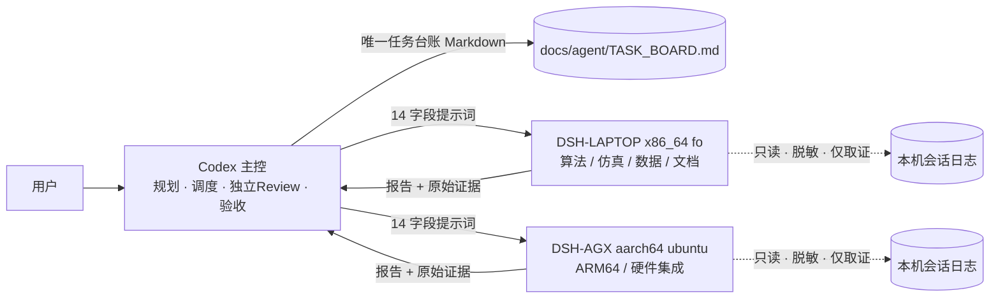

# HEI ReBot Lift 多 Agent 协作工作流

> 本文是**协作流程约定**，不是机器人功能说明，也不产生任何硬件或代码修改授权。
> 建立日期：2026-10-14（Asia/Shanghai）。架构与安全边界以 [README_FOR_AGENTS.md](../README_FOR_AGENTS.md) 为准；
> Git 分支与双机同步以 [git_workflow_zh.md](git_workflow_zh.md) 为准。本文只补充**多 Agent 如何分工、分派、取证和验收**。
>
> **新 Agent 上手顺序**：先读 [README_FOR_AGENTS.md](../README_FOR_AGENTS.md) 与其中引用的架构文档 →
> 再读本工作流 → 然后才接任务。不要先接任务再补背景。

## 1. 目标、范围与规则层级

**目标**

1. 让 Codex、笔记本 DSH、AGX DSH 三者在同一套规则下协作，以 **Markdown 为唯一任务台账**。
2. 每个任务都有可核查的机器指纹、base SHA、命令与原始输出证据，避免"声称完成"。
3. 把**独立 Review 与验收**从执行中分离，执行 Agent 的报告结束不等于验收通过。
4. 明确降级路径：UI 失效、SSH 失败、任务卡住、权限待批、输出截断时如何如实记录而不虚构。

**本次初始化非目标（003-DOCS）**

> 以下为**本轮文档任务**的非目标；未来任务是否开发算法，由其任务书与用户授权决定。

- 不开发机器人算法（本工作的职责是协作基础设施与文档）。
- 不修改机器人代码、驱动参数、标定、环境或硬件状态。
- 不替代 git_workflow：分支模型、上游同步仍按该文档执行。

**规则层级（重要）**

| 层级 | 含义 | 是否延续到后续任务 |
| --- | --- | --- |
| **长期规则** | 安全授权门槛、取证要求、Review 与验收分离、禁止绕过安全联锁 | ✅ 始终适用 |
| **本次约束** | 某一轮任务的只读/禁联网/禁安装/禁硬件/文件白名单（如 003-DOCS） | ❌ 仅该轮；后续按**用户授权 + 任务白名单** |

**证据纪律**：任何"已实现 / 未实现"的结论都必须来自**本轮证据**。
**本轮没有运行仿真，不等于项目没有仿真实现**——不得由"未执行"推断"不存在"。

## 2. 角色与职责

| 角色 | 机器 | 职责 | 不可做 |
| --- | --- | --- | --- |
| **Codex（主控）** | 用户终端的规划端 | 规划、拆解、调度分派、独立 Review、最终验收、**唯一写 TASK_BOARD 者** | 不代替执行 Agent 编造执行证据 |
| **DSH-LAPTOP** | 笔记本 `fo` / x86_64 | 算法、仿真、数据处理、文档实施、x86_64 侧实测 | 不自行扩大 scope、不自行判定 DONE |
| **DSH-AGX** | Jetson AGX Orin / aarch64 | ARM64 构建、硬件集成、实机侧只读核查 | 同上；且不得绕过硬件授权约束 |
| 用户 | — | 授权范围、现场条件、硬件操作许可 | — |

**关键边界**

- 两个 DSH **不共享文件与上下文**；同一文件同一时间只有一个写者。
- 执行 Agent 的"完成"只表示**已提交报告**，状态推进到 `DONE` 只能由 Codex 在验收后写入。
- 执行 Agent 发现计划有误时**停下记录**，不自行改需求、不顺手重构。

## 3. 实测环境与通信（2026-10-14 快照，非永久事实）

### 3.1 双端环境

| 项目 | 笔记本（LAPTOP） | Jetson AGX（AGX） |
| --- | --- | --- |
| 主机 / 架构 | `fo` / x86_64 | `ubuntu` / aarch64（Jetson AGX Orin） |
| 工作目录 | `/home/robo/robotopia/hei-rebot-lift` | `/home/user/hei-rebot-lift` |
| 分支 / SHA | `dev` @ `3bef400fcf6cc9860d16f23f0140f3bb255b2716` | 同一 `dev` / 同一 SHA |
| DSH | `0.2.0-rc.2`，PID 60284，监听 `127.0.0.1:3080` | `0.2.0-rc.2`，PID 18465 |
| 已有未跟踪文件 | `.kilo/`、`协作框架图.svg` | `.kilo/` |
| 默认 Python | miniforge3 base 3.12.12 | base 3.14.7 |
| 业务环境 | `hei-rebot-vr` 3.10.21、`lerobot5` 3.12.15 | `lerobot5` → `/home/user/miniforge3/envs/lerobot5/bin/python` **3.12.14**（已复核）；`rebot` 存在 |

> **DSH 默认解释器（base）不等于机器人环境。** 任何机器人相关命令必须显式选择环境，且本阶段一律不导入机器人库。

### 3.2 三个终端进程与通信路径

| 终端 | 内容 |
| --- | --- |
| pts/4 | 本地 DSH 会话 |
| pts/2（PID 60751） | SSH 会话 |
| pts/3（PID 61088） | `ssh -N -L 3081:127.0.0.1:3081 user@192.168.0.142` 本地端口转发 |

- AGX 的 Web 回环端口 `3081` 通过上述 SSH 隧道映射到本地 `127.0.0.1:3081`。
- **证据边界**：工具只能读取**当前终端**快照；另外两个终端只能用 `ps`/`ss` 核对进程与连接，**不能声称逐屏读取了三个终端**。
- **文档同步状态**：本套文档当前**只存在于笔记本工作区**；AGX **不会自动拥有**，需要时按 git_workflow 同步或由 Codex 单独下发。

### 3.3 已实测能力

**CUA / 探针**

- CUA 已实际读写两页界面、提交双端 001 探针、观察 running 与完成、展开原始命令输出、看到 `PROBE_OK`。
- AGX 业务解释器已复核：`lerobot5` → `/home/user/miniforge3/envs/lerobot5/bin/python`，Python **3.12.14**。
- AGX 侧 `/proc` 复核：`PROBE_PROC_COUNT=0`（后续复核值）。**该值只能说明该次采样未见残留探针进程，不能用来宣称"停止延迟上限"。**

**中断演练（002-CANCEL）**

- 两个 `sleep 45` 中断探针在运行约 **24 秒**时被 Codex 点击停止：UI 显示已停止，工具返回 `Error: tool call aborted`。
- **更正**：执行端此前记录的"开始输出可见"**不实**——实际看到的是"运行中的命令卡"，**没有看到 `START` 的 stdout**。
- **取消语义（源码确认）**：`cancel` 只作用于**当前 turn**，并**保留 inbox 队列**。取消后必须另行核对**队列与残留进程**，不能假设"已全部停止"。
- **状态语义**：子任务状态 `CANCELLED` 属**预期测试结果**（停止能力验证的正常产物），不表示失败；父级"停止能力"验证可由 Codex 判定 `DONE`。
- ⚠️ **取消 DSH 任务 ≠ 机器人急停**：不保证后台任务、队列或硬件动作停止。**严禁把"停止 DSH"当作机器人急停使用。**

**证据文件（AGX）**

- AGX 远端新增 `docs/agent/evidence/20261014-agx-probe.json`，SHA256 `097ccc48f3fe48ae33a25c8f501464b8bbed6bc2a22f3bae3ceb87bcea573d31`；Codex 已看原始输出与文件 diff 并**独立匹配哈希**。
- **文件 owner**：本机 `docs/agent/evidence/` 由 **Codex 单写**；AGX 该 JSON 是 **DSH-AGX 按该任务专门白名单**创建的产物。
  后续按**每个任务声明的文件 owner** 协调，不存在"证据目录全局归某方"的推论。
- 本机核对副本**已落盘**（`docs/agent/evidence/20261014-agx-probe.json`），**不是未来计划**。
- **没有根目录 `evidence/`**；引用一律使用 `docs/agent/evidence/` 下的实际路径。
- **AGX 命令并非全部一次成功**：首次 `/proc` 扫描因 shell 引号错误返回 exit 2
  （`unexpected EOF while looking for matching double quote`）；DSH-AGX 改用 **heredoc 只读重试**成功，
  得到 `PROBE_PROC_COUNT=0`。该次失败已由 Codex 通过 UI 展开核对；**无持续失败、未扩大权限**。

### 3.4 工具可达性现状

- 独立 `ssh` BatchMode 认证失败；**现有 SSH 会话与隧道仍为 ESTAB**（可用，但不代表可新建连接）。
- **API**：已从**安装源码**确认 API 存在，并要求 **Host/Origin 检查与认证 Cookie**；
  本轮**没有执行独立认证 API 调用**，**未实现 API 调度**。本文不提供任何 curl 示例，也不得声称"已集成"。
- CLI 帮助已确认可选形式 `dsh headless --json - < task-prompt.md`；它会启动**新的独立进程/会话**，**未试运行**，且**不能接管当前已锁定的 web 会话**。
- 会话日志实测存在：
  `~/.dsh/sessions/--home-robo-robotopia-hei-rebot-lift--/session-4196ea91-d130-44d7-8b3c-e10c8c30a187/session.v4.jsonl.zstd`
  可用本机 `zstd` **只读流式解码**；必须按明确 session 过滤并脱敏，**不复制整段用户历史**。日志用于**取证**，**不是派发通道**。
- **Web 用量统计/完成时间不能代替证据**；证据必须是原始命令输出与文件 diff。

## 4. 架构（简洁视图）



**唯一真相来源（避免多份真相）**

| 内容 | 位置 |
| --- | --- |
| 架构、约束、证据分级 | [README_FOR_AGENTS.md](../README_FOR_AGENTS.md) |
| Git / 双机同步 | [git_workflow_zh.md](git_workflow_zh.md) |
| 角色、分派、监控、降级 | 本文 |
| 任务台账（Codex 单写） | [agent/TASK_BOARD.md](agent/TASK_BOARD.md) |
| 提示词字段定义 | [agent/TASK_TEMPLATE.md](agent/TASK_TEMPLATE.md) |
| 验收检查项 | [agent/REVIEW_CHECKLIST.md](agent/REVIEW_CHECKLIST.md) |
| 执行与复审记录 | [agent/EXECUTION_LOG.md](agent/EXECUTION_LOG.md) |

> 本文**不复制**模板正文；模板字段以 TASK_TEMPLATE.md 为唯一出处，修改时只改该文件。

## 5. 任务流程（每个开发任务的 Phase 1–8）

下表是**每一个具体任务**（001、002、003…）都要走的工作流程，**不是项目路线图**。
小任务可裁剪每一步的**深度**，但 Phase 6 独立 Review 与 Phase 7 分层测试的**记录**不得省略。
项目级里程碑不在本文定义，由 Codex 在台账或单独规划中维护。

| Phase | 名称 | 必做内容 | 产出 / 证据 |
| --- | --- | --- | --- |
| 1 | **需求分析** | 明确背景、目标、涉及模块、输入输出、依赖；识别**运动风险**（是否涉及电机/底盘/升降）；确定验收标准；列出**关键歧义**并回问用户 | 需求要点 + 歧义清单（未澄清不下发） |
| 2 | **任务规划** | 拆出 Task ID、名称、优先级、执行方、涉及文件、依赖、实施步骤、风险、验收条件、状态 | 台账条目（TASK_BOARD） |
| 3 | **任务分配** | 按双端/跨平台能力拆分（x86_64 仿真数据 vs aarch64 硬件集成）；跨机改动**审查后同步**；确认无共享文件冲突 | 分派决定 + 目标机器/目录/SHA |
| 4 | **生成 14 字段 DSH 提示词** | 用模板生成完整提示词（见 §7） | 一份可直接粘贴的任务提示词 |
| 5 | **执行监控及纠偏** | 按 §8 的可执行步骤确认前置条件、推进状态、回收证据；发现偏差立即纠偏 | 检查点记录 + 原始输出 |
| 6 | **独立 Code Review 与修复循环** | Codex 独立审查（§9）；发现问题 → `NEEDS_FIX` → 执行端最小修复 → 复审 | findings 编号 + 复审记录 |
| 7 | **分层测试验收** | 按 §10 的层级逐级记录**通过/失败/未执行/不适用**与证据 | 分层测试记录 |
| 8 | **总结**（Codex 已验收后的最终归档） | 状态、执行方、涉及文件、实现了什么、Review 结论、实测结果、Git 状态、问题与风险、后续建议 | 最终总结报告——**在 Codex 确认验收之后**产出，不是执行端的"等待验收"报告 |

## 6. 分派规则

1. **按机器能力**：x86_64/仿真/训练/文档 → LAPTOP；ARM64/构建/硬件接入 → AGX。
2. **按风险核对授权**：涉及硬件、环境变更、跨端协议的任务，先核对**该任务已有的授权**与风险等级；
   关键缺项**先澄清再派发**。不得把"未逐项列明"一律当作**永久拒绝**，使已授权的可逆环境工作无法开展。
3. **一文件一写者**：同一文件在任一时刻只有一个写入方；跨端协作文档串行实施。
4. **无共享上下文**：每个任务必须自带完整背景，禁止依赖"另一个 Agent 知道"。
5. **不自行扩 scope**：执行中发现额外问题 → 记录为 finding，交 Codex 决定是否新开任务。
6. **最小授权**：默认只读；写操作必须逐项列白名单，未列出即禁止。
7. **范围来源**：每个任务的允许范围来自**用户授权 + 该任务白名单**。
   **本次约束**（不改算法、不联网、不安装、不访问硬件等）只适用于本轮文档任务，
   **不自动延续**到后续任务；反向地，长期安全门槛（§12.1）也不因某个任务宽松而失效。

## 7. 提示词模板

分派任务时使用 [agent/TASK_TEMPLATE.md](agent/TASK_TEMPLATE.md)，覆盖 14 个字段：
背景、架构、目标、环境、允许文件、禁止文件、技术约束、步骤、测试、交付、验收、异常、Git、报告格式；
并附机器指纹、base SHA、权限范围、硬件授权范围、日志证据要求。

**模板定义只维护一份**（即 TASK_TEMPLATE.md），**允许实例化填写任务计划**；
不要把模板定义再抄一份到本文或 TASK_BOARD。

## 8. 执行监控与纠偏（可执行步骤）

### 8.1 派发前置检查（缺一不可）

1. **通道**：确认目标机 Web 端口可达——笔记本 `127.0.0.1:3080`；AGX 经 SSH 隧道 `127.0.0.1:3081`。
2. **身份**：确认目标机 `hostname`、目标 `cwd`、`git rev-parse HEAD`（base SHA）与任务声明一致。
3. **会话状态**：确认当前 turn 是否已结束；**inbox 队列**是否有未执行任务。
4. **授权**：确认本任务白名单与用户授权一致（§12）。

任何一项不满足 → 不派发，先记录。

### 8.2 状态推进必须有对应证据

| 观察到的现象 | 才可写入的状态 |
| --- | --- |
| 提示词已**输入** → **点击发送** → **看到用户任务回显** | `DISPATCHED` |
| 看到**工具开始运行**（命令卡进入运行中） | `RUNNING` |
| **原始输出 + 文件 diff** 已回收 | `REVIEW` |
| **实际开始独立验证**（测试真正在执行） | `TESTING` |
| 结果全部完成后判断 | `DONE`（Codex 验收通过）或 `NEEDS_FIX`（有 finding） |

> `TESTING` 不是"测试记录写完了"，而是**验证真的开始执行**；
> `DONE` / `NEEDS_FIX` 必须在**结果完成之后**才判定。

- 只在**活跃回合**做检查点轮询（本会话即可），**不部署永久后台监控服务**。
- 无证据不推进状态；"看起来完成了"不是证据。

### 8.3 取消与队列

- `cancel` 只作用于**当前 turn**（已实测），源码确认它**保留 inbox 队列**。
- 取消后必须**分别**核对三件事：当前 turn 是否真的停止、inbox 队列是否仍有任务、是否有残留进程。
- 取消**不等于**机器人急停；涉及运动的任务必须有独立的停止手段与安全措施。

### 8.4 通道不可用时

按 §13 的故障表执行：先停止后续派发，再恢复通道或转**手工降级**，并如实记录失败原因。

## 9. 独立 Review

由 **Codex** 执行，且独立于执行端自述：

1. **展开原始工具输出**核对，而不是相信摘要。
2. 核对机器指纹、base SHA、命令与退出码、证据是否可复现。
3. 核对**任务新增差异 ⊆ 白名单**，且**原有 dirty 状态完整保留**（见 REVIEW_CHECKLIST C 节）。
4. 核对结论与证据的强度匹配（静态检查 ≠ 功能验收）。
5. 记录 findings（编号 + 优先级 + 证据），执行端更正后复审并记录结论。

详见 [agent/REVIEW_CHECKLIST.md](agent/REVIEW_CHECKLIST.md)。

## 10. 分层测试与验收记录

测试层级**逐级独立**。每级都必须记录 **通过 / 失败 / 未执行 / 不适用** 及**证据**
（命令、退出码、原始输出、文件 diff）。

| 层级 | 名称 | 内容 | 记录要求 |
| --- | --- | --- | --- |
| L0 | **环境探针**（可选附加） | hostname/架构/cwd/SHA/解释器版本/端口/标准库探针 | 原始输出 |
| L1 | **静态** | 链接、`git diff --check`、语法解析、lint/类型检查 | 命令 + 退出码 |
| L2 | **单元** | 无硬件依赖的单函数/单类测试（含假对象） | 用例数 / 通过数 |
| L3 | **模块集成** | 模块间接口、数据流、协议编解码往返 | 集成用例与结果 |
| L4 | **本地仿真** | MuJoCo 等纯仿真链路 | 场景、步数、结果 |
| L5 | **AGX 软件环境** | 在 AGX 上验证依赖可导入、环境版本、构建产物 | 环境与导入记录 |
| L6 | **硬件非运动** | 只读设备枚举、串口/CAN 在线状态、限位 IO、参数读取（**不使能、不运动**） | 原始反馈 |
| L7 | **实机运动** | 使能、运动、回零、联调 | **仅用户明确批准**；记录授权来源与现场条件 |

**四类结论必须分开陈述，不得互相代替**：

1. **代码实现**（代码已写）≠ 2. **仿真通过**（L4 通过）≠ 3. **AGX 部署**（L5 通过；**仅查版本不算**）
≠ 4. **实机通过**（**L7** 通过；**L6 通过不等同**）。

- **层级按任务目标选择**：**文档任务通常 L1**；**仿真任务按其目标执行 L2/L3/L4**。
  两者都**不需要**无关的硬件确认或额外授权流程。
- **仅查询版本不构成"AGX 部署通过"**：L5 需依赖可导入、构建产物等实际验证，版本号本身不是部署结论。
- **L6 通过不能宣称运动通过**：L6（硬件非运动）与 L7（实机运动）的结论必须**拆开**陈述。
- 涉及运动的任务：L7 前置条件必须逐项满足并留证。
- 不得跨层宣称：L1–L3 的结果不能表述为 L4–L7 已验证。

## 11. Git 协同

- 沿用 [git_workflow_zh.md](git_workflow_zh.md)：功能走任务分支或隔离 worktree，共享分支不重写历史。
- **本次例外记录**：003-DOCS 为串行文档任务，直接在 `dev` 工作区实施，不新建分支；这与"优先任务分支"的默认约定不同，属明确记录的例外。
- 禁止强推、`reset --hard`、上游推送、清理用户未跟踪文件。
- 代码同步必须记录 **SHA 或明确文件哈希**；不同 DSH 不共享文件与上下文。
- 本次任务**不自动 commit/push**；改动以工作区状态交付给 Codex Review。
- **注**：`不 commit/push` 属**本轮约束**；未来任务是否提交由用户授权与该任务白名单决定。

## 12. 安全与授权

### 12.1 长期规则（任何任务都适用）

- 涉及**电机使能、双臂/底盘/升降运动、关键参数修改、零点标定、固件刷写、解除保护**等的操作，
  必须获得**用户逐项明确授权**；平台或流程层面的授权**不包含**这些。
- **每个任务都必须写清硬件的允许/禁止范围**；**无授权不得进行硬件访问**。
  **本次初始化（003-DOCS）全部禁止硬件访问。**
- 使能、运动、标定、固件、参数写入等**危险操作必须获得用户明确授权，且永不绕过安全联锁**
  （反馈检查、限位、看门狗、解锁逻辑、急停）。
- 普通**只读**硬件核查（L6）按**该任务已有授权**执行，不要求为每次只读访问重新逐项确认。
- 保持 **host 单客户端**、完整 **18 维动作 / 三相机协议**与单位约定；ROS 2 仍为骨架。
- 不读取/输出/提交 token、私钥、证书；示例使用占位符。
- **取消或停止 DSH 不等于机器人急停。**

### 12.2 本次初始化（003-DOCS）的范围约束

以下属于**本轮文档任务**的约束，**不是永久规则**：

- 不改动机器人算法与代码、不修改环境与依赖、不安装、不联网、不访问硬件或凭据、不 commit/push。
- 仅允许既定文件白名单内的改动；**TASK_BOARD 已初始化，之后由 Codex 单写**。

**未来任务**的允许范围由**用户授权 + 该任务白名单**决定，不沿用本轮的"只读"口径。

## 13. 常见故障与降级处理

| 故障 | 现象 | 降级处理 | 禁止 |
| --- | --- | --- | --- |
| UI 过期 | 页面状态落后于实际 | 刷新页面；以会话日志或 `ps` 复核 | 依据过期 UI 下结论 |
| UI 失联 | 页面不可达/无响应 | **停止后续派发**，先恢复通道（刷新、检查隧道） | 盲目重试、并发重复派发 |
| SSH 失败 | BatchMode 认证失败、新连接被拒 | 记录原始错误；复用**仍 ESTAB** 的现有会话/隧道；仅用 `ps`/`ss` 核对 | 声称已远程执行、编造远端输出 |
| 隧道断开 | `3081` 不可达 | 停止依赖该通道的步骤并上报 | 改用未经验证的替代通道 |
| 任务卡住 | 长时间无输出 | Codex 检查点介入；确认 **inbox 队列与残留进程**后再决定重派 | 静默重试 |
| 队列残留 | cancel 后仍有待执行任务 | 单独核对队列与进程，逐个处理 | 把 cancel 当作"全部停止" |
| 权限待批 | 操作被策略拒绝 | 记录拒绝原因，交用户/Codex 决策 | 绕过沙箱、索取更宽权限 |
| 输出截断 | 长输出被截断 | 读取落盘的完整输出文件；按需分段 | 依据截断片段推断结论 |
| 直接 API | **有源码证据、无调用实测** | 标注"源码确认存在 Host/Origin 检查与认证 Cookie；本轮未调用、未实现调度" | 编写虚构 curl 接口、声称已集成或输出凭据 |
| CLI 接管 | 想用 headless 接管当前会话 | 明确其会开**新独立进程/会话**且未试运行，**不能接管**已锁定的 web 会话 | 声称已用 CLI 接管 |
| 需人工介入 | 通道全部不可用 | **手工降级**：用户进入正确目录、用正确端口打开对应 DSH，粘贴 §7 生成的 14 字段提示词，回传**原始输出 + diff/退出码** | 用自然语言转述代替原始输出 |

## 14. 真实案例（证据驱动改进）

**案例 1：001-LAPTOP 误读转义文件名（RF-001，P2）**

- 执行端在首次报告中**误读转义文件名**，把两次 `git status` 中**实际相同**的文件名当成"差异"，
  进而推断为"核查期间有并发进程重命名文件"，并归因到 Kilo 进程，写成"已确认"。
- Codex **展开首末两次原始工具输出**核对，证明两者为同一文件名 `协作框架图.svg`；
  且目录 mtime 早于任务开始时间。**没有任何已证实的并发修改。**
- 结论：执行端**撤回**该结论与归因，Codex 接受更正。
- **教训（本文档据此建立规则）**：
  1. 推断必须标注为推断，"确认"只能用于有原始输出直接支持的事实。
  2. 转义/编码输出应**解码后逐字比对**，不凭肉眼记忆。
  3. 时间戳先后关系不构成因果证据。
  4. **独立 Review 能拦截错误结论**——这正是 Review 与执行分离的价值。

**案例 2：双端 001 只读探针**

- 笔记本与 AGX 的 `hostname`/`uname -m`/根目录/SHA/`PROBE_OK` 原始输出经 Codex 展开核对，构成可信基线。
- AGX 业务环境随后复核为 `lerobot5` Python **3.12.14**。

**案例 3：002-CANCEL 的"看起来成功了"**

- 执行端曾记录"开始输出可见"，但 Codex 核对发现实际只看到**运行中的命令卡**，**没有 `START` 的 stdout**。
- 教训：中断类证据必须区分"界面显示在运行"与"确实收到开始输出"；后者需要原始 stdout。
- 同时确认 `cancel` **保留 inbox 队列**，所以"取消成功"不等于"系统已清空"。

## 15. 状态机与台账

```text
TODO → PLANNED → DISPATCHED → RUNNING → REVIEW → TESTING → DONE
                     ↘ BLOCKED   ↘ FAILED   ↘ NEEDS_FIX   ↘ CANCELLED
```

- **只有 Codex 在确认验收后才能写入 `DONE`**；DSH 报告结束 ≠ 验收通过。
- `CANCELLED` 是**合法的预期结果**（例如停止能力演练），不表示失败。
- `NEEDS_FIX` 由 Review findings 触发，执行端更正后回到 `REVIEW`。
- 台账文件 [agent/TASK_BOARD.md](agent/TASK_BOARD.md) **由 Codex 单写**，DSH 仅按指令初始化，之后不改。

## 16. 维护约定

- 流程变化时只改本文；模板字段变化只改 TASK_TEMPLATE.md；模板测试层级与本文 §10 必须保持一致。
- 新增协作相关文件前先确认是否会造成"多份真相"。
- **跨机同步**：本套文档当前只在笔记本工作区；AGX 不会自动拥有，需要时按 git_workflow 同步或由 Codex 单独下发。
- 本文为中文主文档；如需英文版应单独建立并保持结构对齐，**不要**在本文内混排两套。
